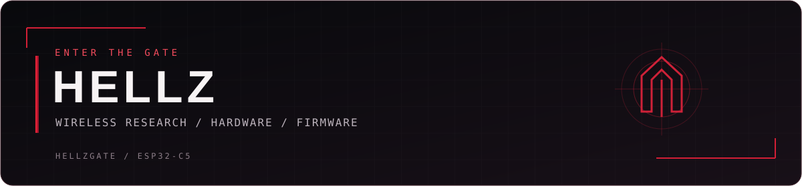

  

Building **HellzGate**, a multi-node wireless research platform based on ESP32-C5 hardware.

  
  
  

  <a href="https://hellzgate.com/">Website</a> ·
  <a href="https://github.com/Hellz0wnzJ00/hellzgate-espnow-cluster">Firmware</a> ·
  <a href="https://discord.gg/hellzgate">Community</a>

---

## HellzGate ESP-NOW Cluster Firmware — Open-Source Beta

**Master + scanner/node firmware for ESP32-C5.** Now available under MIT for community forks, experimentation and improvements.

- [Browse and fork the source](https://github.com/Hellz0wnzJ00/hellzgate-espnow-cluster)
- [Beta download and release notes](https://github.com/Hellz0wnzJ00/hellzgate-espnow-cluster/releases/tag/v0.1.0-beta.1)

Experimental, not a final or production release. The supplied configurations support up to 20 scanners; this beta's 20-scanner field validation remains pending. See the repository for build instructions, hardware adaptation guidance and testing limits.

From the **HellzGate Project by Hellz (Sean Clossey)**. Fork it, build on it, and share what you learn.

> Some people spoon, we fork. Have fun and be safe! - Hellz

**Current hardware focus:** C5 FullGate — one master and nine physical scanner slots. Separate ESP-NOW and wired I²C bench and field logging completed; hardware and firmware validation continue.

- [HellzGate website](https://hellzgate.com/)
- [Project updates, hardware photos, and setup guide](https://github.com/Hellz0wnzJ00/hellzgate)

## Wireless field stats

  

  

  

  

---

## Open-source contribution

Investigated ESP32-C5 I²C slave failures and proposed fixes, acknowledged in Espressif's merged [PR #12952](https://github.com/espressif/arduino-esp32/pull/12952).

The ESP-NOW Cluster Firmware beta is open source in its separate repository. Production firmware and private hardware design files are not published here. For education, research and authorized testing.
